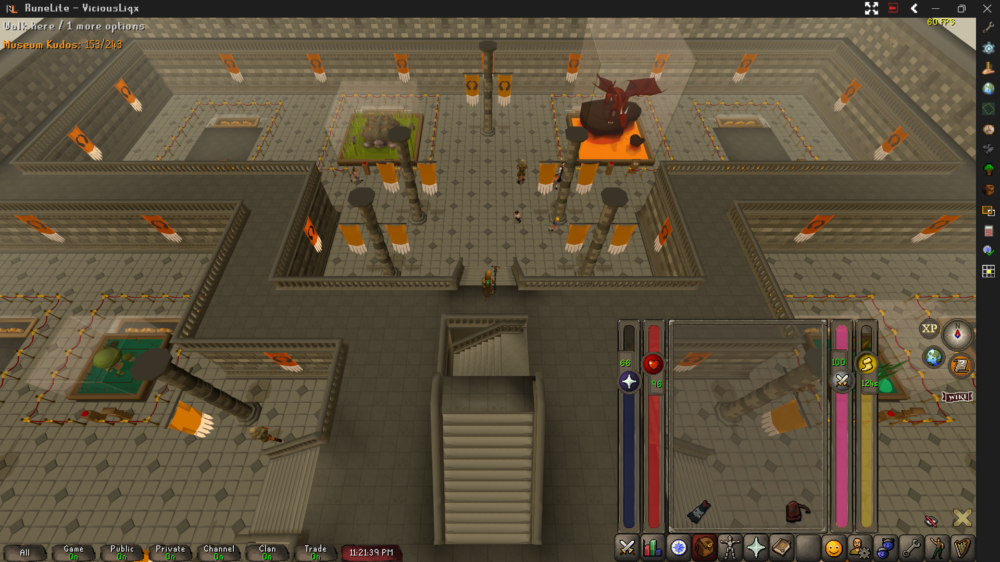
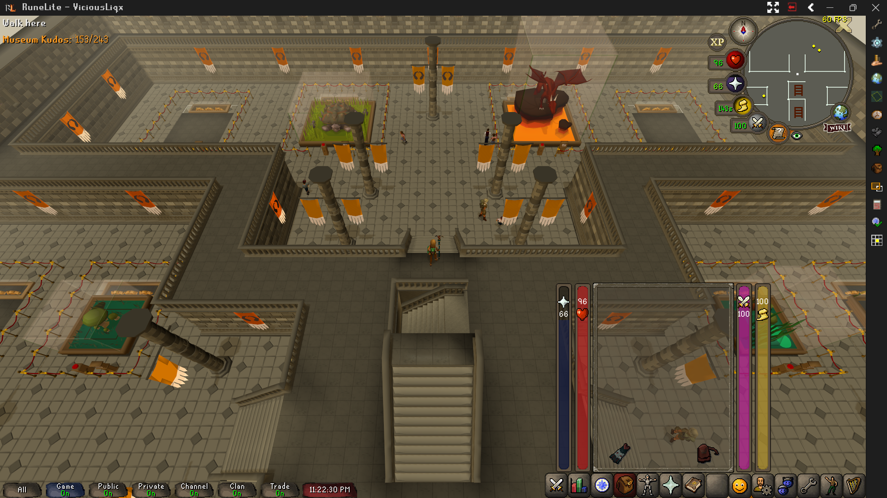
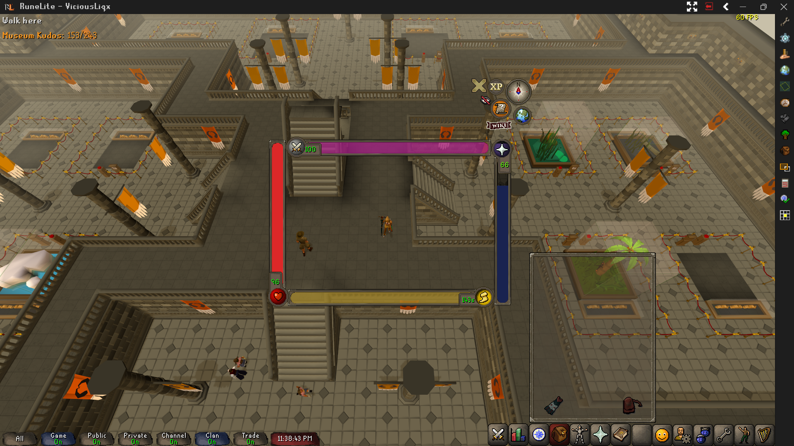

# Vicious Bars

A full visual overhaul for the HP, Prayer, Special Attack, and Run Energy orbs, with matching non-interactive overlay bars and two extras that have no vanilla equivalent: a Wintertodt warmth bar and a current-target enemy HP bar.

Orientation, size, and position are all independent per bar - everything below is one plugin, just dragged into a completely different layout:

## Features

**Main bars** (HP, Prayer, Special Attack, Run Energy)
- Each bar is independently configurable: orientation (North/South/East/West), length, width, frame thickness/shadow/opacity, bar opacity, and fill colors
- State-based coloring - HP (normal/poisoned/envenomed/diseased), Prayer (active/inactive), Special Attack and Run (default/active)
- Regen/drain progress rings for prayer point regeneration, special attack recharge, and poison/disease countdowns
- A threshold glow that lights up the bar when a stat crosses a limit you set (configurable mode and direction)
- Reverse-direction toggles for the bar fill and both rings, independently per bar
- An option to hide the real orb's own native depletion effect, since the bar already shows it
- Drag-and-drop repositioning in an edit mode, with an optional alignment grid

**Aux bars** (non-interactive overlay versions)
- HP, Prayer, Special Attack, Run, Warmth, and current-target Enemy HP
- Dock to the inventory panel or float freely, independent of the main bars' placement
- Automatically shown when a main bar is hidden (configurable per bar)

**Hotkeys** (all unbound by default)
- Toggle the main bars - the same action as clicking the minimap's own toggle
- Toggle edit mode for repositioning the main bars
- Hide all aux bars regardless of their individual settings

## Configuration

Every bar (main and aux) has its own configuration section covering size, position, colors, thresholds, and regen/drain behavior. Edit mode (hotkey or right-click) lets you drag bars into place directly rather than typing in offsets.

## Installation

Once available on the RuneLite Plugin Hub, search for "Vicious Bars" in the Plugin Hub browser inside the RuneLite client.

## License

BSD 2-Clause. See [LICENSE](LICENSE).
